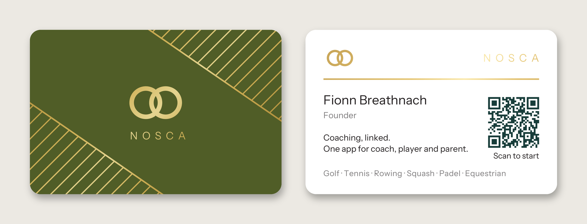

# The business card

Print files for MOO's gold foil business cards, generated by
`scripts/business-card.py` from the mark's own geometry
(`src/lib/brandmark.jsx`), and the order to place. Nothing here is drawn
by hand: change the script, run it, commit what it writes.



## What to order

MOO (moo.com — the `/eu` site serves Ireland in euro, the `/uk` site the
same product in sterling) › Business Cards › **Gold Foil**.

| Choice | Pick | Why |
|---|---|---|
| Paper | **Super, 380 gsm, Soft Touch finish** | The only MOO paper that takes foil — Luxe does not (MOO's Luxe support page: no foil or spot gloss on Luxe). Soft Touch is the velvety matte of the sample card in hand; matte also scans best, since a gloss would throw light back at the phone. |
| Size | **MOO size, 84 × 55 mm** | The standard card in Ireland and the UK; the files are cut to it. |
| Corners | **Rounded** | A small extra on the configurator. |
| Foil | **Gold, both sides** | Both sides at no extra cost. |
| Design | Upload your own, double-sided | Two files a side, below. |
| Quantity | **50** to start | From £39 on the UK site. Hold the first fifty before ordering two hundred: a foil card is judged in the hand, not on a screen. |

## The files

MOO takes the foil as a file of its own beside the colour artwork — black
shapes (CMYK 0/0/0/100) on white, vector — one per side. So each side is
two uploads:

| Side | Upload as the artwork | Upload as the foil layer |
|---|---|---|
| Front (green) | `nosca-card-front-colour.pdf` | `nosca-card-front-foil.pdf` |
| Back (white) | `nosca-card-back-colour.pdf` | `nosca-card-back-foil.pdf` |

`png/` holds the same four files as 600 dpi images (2079 × 1394 px, the bleed
included) for a phone that will not open the PDFs; MOO takes PNG for the
colour artwork. Upload the PDFs where you can — they are vector, and MOO's
foil guide asks for a PDF.

Every PDF is 88 × 59 mm — the 84 × 55 trim with MOO's 2 mm bleed all
round — and carries the trim as its TrimBox. Do not add crop marks; MOO
adds its own. `alt-olive/` is the same front on a dark olive ground, in
case the olive the founder floated is preferred in the hand; the back is
shared.

## What is on it

**Front.** The brand's bottle green edge to edge (the colour of the app
icon the person is about to put on their phone), fine gold pinstripes
across the top and bottom thirds, and a clear band through the middle
with the mark and NOSCA — the composition of MOO's own gold-foil sample,
and the lockup of the app's front door. The ground is the only printed
thing on this side; everything gold is foil.

**Back.** White. The mark in gold top left and NOSCA in green top right;
Fionn Breathnach, Founder; one line of what Nosca is and the six sports;
two codes with what each does — **Open Nosca** and **Add to phone**.
Only the mark is foil; the rest is printed, so the name and the codes
read in any light.

## The codes

| Caption | Points to | What happens |
|---|---|---|
| Open Nosca | `https://nosca-pilot-2.netlify.app/` | Sign-up, or the app for a member. |
| Add to phone | `https://nosca-pilot-2.netlify.app/install` | The Home Screen guide: iPhone · Android · Computer, opened on the device it is read on, with the browser's own Install button where it offers one. The same guide is Settings › Add to Home Screen and the arrival screen's line after sign-up. |

Version 3 codes (29 modules) at error level M, drawn as vector squares
16.5 mm wide — 0.57 mm a module, over the 0.5 mm phones read with ease
— in the brand green (11:1 against the paper; 4:1 is the floor), with
2.5 mm of clear paper between them and 6 mm to the card's edge, so each
has the four-module quiet zone the standard asks for. Both were read
back from a print-resolution render of the back file with OpenCV before
this was committed. **Scan the printed proof with two phones before
handing any out.**

If the app moves to a domain of its own, regenerate with
`--site https://<domain>` — the codes carry the site's root and
`/install`, nothing else, so nothing in the design changes.

## MOO's rules, and where the card stands

| Rule | MOO | This card |
|---|---|---|
| Bleed · trim · safe area | 88 × 59 · 84 × 55 · 80 × 51 mm | 88 × 59, trim boxed; nothing closer than 6 mm to the trim |
| Foil file | Separate, black 0/0/0/100, vector, PDF | Yes, one per side |
| Foil under printed artwork | Avoid — it halos when the two drift | Nothing is printed under any foil shape |
| Foil lines | 1 pt or thicker | Pinstripes 0.40 mm (1.13 pt); the small mark's rings 0.69 mm (1.95 pt); the large mark's 1.51 mm |
| Foil type | 10 pt or larger | NOSCA on the front, 10 pt |
| Foil coverage a side | Under 30 % (support article; the product page says under 50 %) | 8.1 % front, 0.4 % back, measured off the render |
| Printed type | 8 pt or larger | 8 pt and up, bar the two code captions at 7.5 pt, which must not outgrow their codes |
| Colour | CMYK | Every colour is a CMYK build (the green C85 M35 Y55 K60) |
| Fonts | Embedded or outlined | Embedded subsets of Instrument Sans (SIL Open Font License; `scripts/card/fonts/`) — the face the app itself names after Switzer, which cannot be fetched from this machine |

Sources: MOO's gold foil design guidelines and product pages (UK and
US), the general business card guidelines (safe area, 8 pt, vector PDF,
no crop marks), the Luxe support article (no foil on Luxe), the gold
foil support article (foil under 30 %), and the gold foil options page
(380 gsm Super, Soft Touch, 84 × 55 mm, from £39 for 50).

## Regenerating

```sh
python3 -m pip install reportlab qrcode pillow numpy   # once; pdftoppm for the previews
python3 scripts/business-card.py                        # → docs/brand/business-card/
python3 scripts/business-card.py --ground olive --out docs/brand/business-card/alt-olive
```

The previews simulate the foil (a gold gradient where the foil file is
black), trim the bleed and round the corners; the PDFs themselves hold
the foil as black, as MOO wants it.
